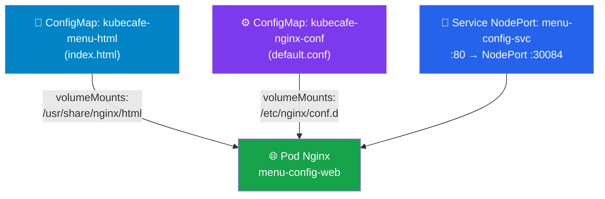
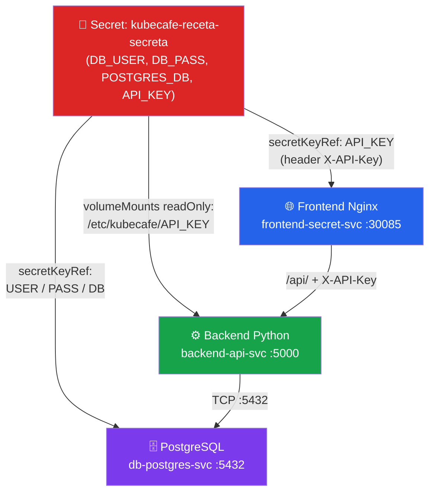
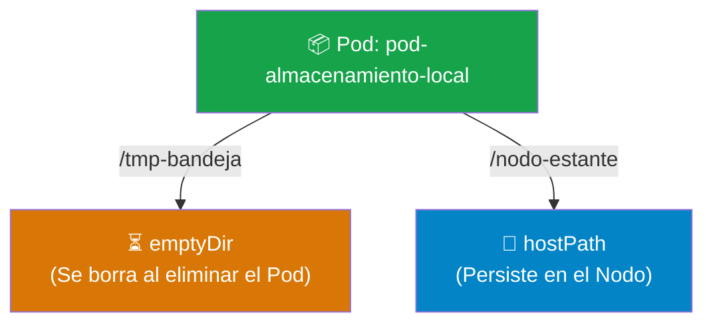
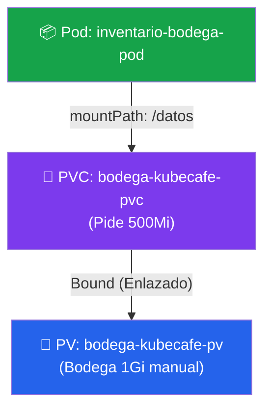
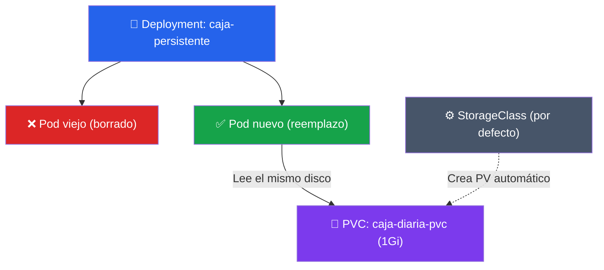

# 🧪 Ejemplos Prácticos de la Semana 04: ConfigMaps, Secrets y Almacenamiento

¡Bienvenido a los laboratorios de la **Semana 04**!  
Esta guía está pensada paso a paso para que cualquier persona —incluso si es tu primera vez con Kubernetes— entienda **qué hace cada comando**, **qué debería responder la terminal** y **por qué ocurre**.

---

## 📦 Paso 0: Prepara tu Entorno (Clonar y Ruta de Trabajo)

Todos los comandos de esta semana se ejecutan desde la **raíz del repositorio (`Fundamentos-Kubernetes`)**:

```bash
# 1. Clonar el repositorio oficial (si aún no lo tienes)
git clone https://github.com/edwinbermudez91/Fundamentos-Kubernetes.git 2>/dev/null || true

# 2. Entrar a la raíz del repositorio y traer los últimos cambios
cd Fundamentos-Kubernetes
git pull origin main
```

---

## 📑 Índice de Ejemplos

| Manifiesto | Concepto Clave | Equivalente en ☕ KubeCafé |
| :--- | :--- | :--- |
| [`01-configmap-variables-entorno.yaml`](./01-configmap-variables-entorno.yaml) | `ConfigMap` con `envFrom` | Tablero de precios inyectado al barista al abrir turno. |
| [`02-configmap-volumen-archivo.yaml`](./02-configmap-volumen-archivo.yaml) | `ConfigMap` montado como archivo | Carta HTML colgada en Nginx sin reconstruir la imagen. |
| [`03-secret-credenciales.yaml`](./03-secret-credenciales.yaml) | `Secret` (`env` + volumen `readOnly`) | Clave de caja fuerte y API Key en bóveda protegida. |
| [`04-volumen-emptydir-vs-hostpath.yaml`](./04-volumen-emptydir-vs-hostpath.yaml) | `emptyDir` vs `hostPath` | Bandeja temporal en barra vs estante fijo del nodo. |
| [`05-pv-pvc-almacenamiento-persistente.yaml`](./05-pv-pvc-almacenamiento-persistente.yaml) | `PV` + `PVC` (`manual`) | Bodega física (`PV`) reservada mediante contrato (`PVC`). |
| [`06-storageclass-dinamico-stateful.yaml`](./06-storageclass-dinamico-stateful.yaml) | `PVC` dinámico + `Deployment` | Caja registradora cuyos registros sobreviven al borrar el Pod. |

---

## 🧂 Laboratorio 1: `ConfigMap` como Variables de Entorno

### 💡 ¿Qué aprenderás?
En lugar de escribir configuraciones fijas dentro del código o la imagen Docker (como el precio del tinto o la moneda), las guardamos aparte en un **`ConfigMap`** y se las pasamos al contenedor como **variables de entorno** (`envFrom`).

### Paso 1: Aplica el manifiesto y espera a que el Pod arranque
```bash
kubectl apply -f semana-04-configuracion-almacenamiento/1.ejemplos/01-configmap-variables-entorno.yaml
kubectl wait --for=condition=ready pod/barista-config-env --timeout=60s
```
> 💡 **Respuesta esperada:**
> ```text
> configmap/kubecafe-config created
> pod/barista-config-env created
> pod/barista-config-env condition met
> ```

### Paso 2: Lista y accede al contenido del `ConfigMap`
```bash
# Listar todos los ConfigMaps del namespace (forma corta: cm)
kubectl get configmaps
kubectl get cm

# Ver detalles y claves del ConfigMap
kubectl describe configmap kubecafe-config

# Acceder al contenido completo en formato YAML
kubectl get configmap kubecafe-config -o yaml
```
> 💡 **Respuesta esperada (`describe` / `-o yaml`):** Verás las 4 claves definidas en `data`: `NOMBRE_LOCAL`, `MONEDA`, `PRECIO_TINTO` y `MODO_DEBUG`.

### Paso 3: Inspecciona el Pod con `describe`, `logs` y `exec`
```bash
# 1. Ver en el Pod que las variables están conectadas al ConfigMap
kubectl describe pod barista-config-env

# 2. Ver la salida impresa al iniciar el contenedor
kubectl logs barista-config-env

# 3. Validar las variables directamente dentro del contenedor con exec
kubectl exec barista-config-env -- env | grep -E "NOMBRE_LOCAL|MONEDA|PRECIO_TINTO|MODO_DEBUG"

# (Opcional) Entrar en modo interactivo al contenedor y consultarlas manualmente
kubectl exec -it barista-config-env -- sh
# Dentro del Pod ejecuta: echo "$NOMBRE_LOCAL | $MONEDA | $PRECIO_TINTO" && exit
```
> 💡 **Respuesta esperada:**
> - En `kubectl describe pod barista-config-env` verás la sección `Environment Variables from: kubecafe-config ConfigMap`.
> - En `kubectl logs` y `kubectl exec` confirmarás los valores reales dentro del contenedor:
> ```text
> NOMBRE_LOCAL=KubeCafé Medellín
> MONEDA=COP
> PRECIO_TINTO=3500
> MODO_DEBUG=false
> ```

---

## 📄 Laboratorio 2: `ConfigMap` para Web HTML, Config de Nginx y `NodePort`

### 💡 ¿Qué aprenderás?
Un `ConfigMap` también puede montarse como **archivos reales** dentro del contenedor (`volumeMounts`). Aquí usamos **dos ConfigMaps** sin reconstruir la imagen:
- `kubecafe-menu-html` → monta `index.html` en `/usr/share/nginx/html`.
- `kubecafe-nginx-conf` → monta `default.conf` en `/etc/nginx/conf.d` (agrega el header `X-KubeCafe-Config` y el endpoint `/healthz`).
- Y exponemos el servicio con **`type: NodePort`** en el puerto **`30084`**.



### Paso 1: Despliega Nginx con ambos `ConfigMaps` y el `Service NodePort`
```bash
kubectl apply -f semana-04-configuracion-almacenamiento/1.ejemplos/02-configmap-volumen-archivo.yaml
kubectl wait --for=condition=ready pod -l app=menu-config-web --timeout=60s
kubectl get configmaps
kubectl get pods,svc -l app=menu-config-web
```
> 💡 **Respuesta esperada:**
> ```text
> configmap/kubecafe-menu-html created
> configmap/kubecafe-nginx-conf created
> deployment.apps/menu-config-web created
> service/menu-config-svc created
> ```

### Paso 2: Inspecciona los archivos montados (`exec`) y prueba por `NodePort` (`30084`)
```bash
# 1. Verificar ambos archivos montados dentro del contenedor
kubectl exec deployment/menu-config-web -- ls -la /usr/share/nginx/html /etc/nginx/conf.d
kubectl exec deployment/menu-config-web -- cat /etc/nginx/conf.d/default.conf

# 2. Obtener la IP de un nodo y probar el Service NodePort :30084
NODE_IP=$(kubectl get nodes -o jsonpath='{.items[0].status.addresses[?(@.type=="InternalIP")].address}')
curl -i http://$NODE_IP:30084/healthz
curl -s http://$NODE_IP:30084 | grep -E "h1|li"
```
> 💡 *(Si estás en **macOS/Windows con Docker Desktop** y la IP interna del nodo no es alcanzable desde tu navegador, usa un túnel rápido: `kubectl port-forward svc/menu-config-svc 8084:80` y abre `http://localhost:8084` o `http://localhost:8084/healthz`).*
> 💡 **Respuesta esperada:**
> - En `/healthz` verás `OK - Nginx configurado desde ConfigMap`.
> - En `/` verás el header `X-KubeCafe-Config: ConfigMap-Nginx` y el menú HTML:
> ```html
>       <h1>☕ Menú KubeCafé — Cargado desde ConfigMap</h1>
>         <li>Tinto Campesino — $3.500 COP</li>
>         <li>Espresso Doble — $5.000 COP</li>
>         <li>Capuccino Vainilla — $7.500 COP</li>
> ```
> 📌 **Dato clave:** Si editas cualquiera de los dos `ConfigMaps` (`kubectl edit cm kubecafe-menu-html` o `kubecafe-nginx-conf`), Kubernetes actualiza el archivo dentro del contenedor automáticamente (~60 segundos) sin reconstruir la imagen.

### Paso 3: Cambia por otro `ConfigMap` y recrea el Pod para que tome la nueva config
Cuando quieres cambiar a un **nuevo `ConfigMap`** (por ejemplo `kubecafe-nginx-conf-v2` para una nueva versión o entorno) sin borrar el `Deployment`, actualiza la referencia del volumen en el `Deployment` para que Kubernetes **recree el Pod automáticamente**:

```bash
# 1. Crear un segundo ConfigMap con la nueva configuración de Nginx (v2)
kubectl apply -f - <<'EOF'
apiVersion: v1
kind: ConfigMap
metadata:
  name: kubecafe-nginx-conf-v2
data:
  default.conf: |
    server {
        listen 80;
        server_name localhost;

        location / {
            root /usr/share/nginx/html;
            index index.html;
            add_header X-KubeCafe-Config "ConfigMap-Nginx-v2" always;
        }

        location /healthz {
            default_type text/plain;
            return 200 "OK - Nginx v2 desde nuevo ConfigMap\n";
        }
    }
EOF

# 2. Cambiar el volumen del Deployment al nuevo ConfigMap (esto recrea el Pod automáticamente)
kubectl set volume deployment/menu-config-web --add --overwrite \
  --name=nginx-conf-vol \
  --type=configmap \
  --configmap-name=kubecafe-nginx-conf-v2 \
  --mount-path=/etc/nginx/conf.d \
  --read-only

# (Tip: si en vez de cambiar de ConfigMap editas variables envFrom, fuerza la recreación con:)
# kubectl rollout restart deployment/menu-config-web

# 3. Esperar al nuevo Pod y verificar con describe + curl que tomó el nuevo ConfigMap
kubectl rollout status deployment/menu-config-web
kubectl describe pod -l app=menu-config-web | grep -A 3 "nginx-conf-vol"
curl -i http://$NODE_IP:30084/healthz
```
> 💡 **Respuesta esperada:** Verás que nació un Pod nuevo, en `describe` aparece `Name: kubecafe-nginx-conf-v2`, y `/healthz` ahora responde **`OK - Nginx v2 desde nuevo ConfigMap`** (y `/` trae el header `X-KubeCafe-Config: ConfigMap-Nginx-v2`).

---

## 🔐 Laboratorio 3: App 3 Capas con `Secret` (Frontend ➔ Backend ➔ PostgreSQL)

### 💡 ¿Qué aprenderás?
Los datos confidenciales (contraseñas de base de datos, tokens, `API_KEY`) **no** deben ir en `ConfigMaps`, sino en un **`Secret`**. Aquí desplegamos una mini aplicación completa de **3 capas** compartiendo un mismo `Secret` (`kubecafe-receta-secreta`):
- **Frontend (`frontend-secret-web`, `NodePort :30085`):** toma `API_KEY` del `Secret` (`secretKeyRef`) y la envía en el header `X-API-Key` cuando hace proxy a `/api/`.
- **Backend API (`backend-api`, `ClusterIP :5000`):** monta el `Secret` como archivo (`readOnly: true` en `/etc/kubecafe/API_KEY`), valida la `X-API-Key` del Frontend y verifica conexión real con la base de datos usando `DB_USER` y `DB_PASS`.
- **Base de datos (`db-postgres`, `ClusterIP :5432`):** arranca PostgreSQL con `POSTGRES_USER`, `POSTGRES_PASSWORD` y `POSTGRES_DB` leídos del mismo `Secret`.



### Paso 1: Despliega la app de 3 capas con el `Secret`
```bash
kubectl apply -f semana-04-configuracion-almacenamiento/1.ejemplos/03-secret-credenciales.yaml
kubectl wait --for=condition=available deployment/db-postgres deployment/backend-api deployment/frontend-secret-web --timeout=120s
kubectl get pods,svc
```

### Paso 2: Lista e inspecciona el `Secret` y los Pods (`describe` y `exec`)
```bash
# 1. Listar Secrets y ver sus claves (sin revelar los valores)
kubectl get secrets
kubectl describe secret kubecafe-receta-secreta

# 2. Ver el Secret completo en Base64 y decodificar una clave puntual
kubectl get secret kubecafe-receta-secreta -o yaml
kubectl get secret kubecafe-receta-secreta -o jsonpath='{.data.DB_PASS}' | base64 -d && echo

# 3. Ver en el Backend que las variables y el volumen secreto están conectados
kubectl describe pod -l app=backend-api

# 4. Validar dentro del Backend con exec (variables + archivo readOnly)
kubectl exec deployment/backend-api -- env | grep -E "DB_USER|DB_PASS|POSTGRES_DB"
kubectl exec deployment/backend-api -- cat /etc/kubecafe/API_KEY
kubectl exec deployment/backend-api -- touch /etc/kubecafe/prueba.txt
```

### Paso 3: Prueba la conexión Frontend ➔ Backend ➔ PostgreSQL por `NodePort` (`30085`)
```bash
NODE_IP=$(kubectl get nodes -o jsonpath='{.items[0].status.addresses[?(@.type=="InternalIP")].address}')

# 1. Llamar vía Frontend (inyecta X-API-Key automáticamente desde el Secret -> HTTP 200)
curl -s http://$NODE_IP:30085/api/status

# 2. Llamar directo al Backend SIN X-API-Key (debe rechazar con HTTP 401 Unauthorized)
kubectl exec deployment/frontend-secret-web -- wget -qO- http://backend-api-svc:5000/status || echo "Rechazado (401) sin API_KEY"
```
> 💡 **Respuesta esperada en `/api/status`:**
> ```json
> {"status": "ok", "auth": "API_KEY del Secret validada", "db": "db-postgres-svc:5432 CONECTADA", "db_user": "barista_admin", "db_name": "kubecafe"}
> ```
> *(En macOS/Windows con Docker Desktop también puedes abrir `http://localhost:30085` usando `kubectl port-forward svc/frontend-secret-svc 30085:80`).*
> ⚠️ **Importante para principiantes:** Base64 (`echo -n "TintoSeguro2026!" | base64`) es codificación, **no cifrado**. En repositorios reales nunca subas contraseñas reales en texto plano; usa herramientas como *Sealed Secrets* o *External Secrets*.

---

## ⏳ Laboratorio 4: `emptyDir` (Efímero) vs `hostPath` (Nodo)

### 💡 ¿Qué aprenderás?
Por defecto, si un Pod se borra, todo lo que guardó en su capa efímera desaparece. Aquí comparamos dos volúmenes locales de forma sencilla:

| Volumen | Dónde guarda los datos | ¿Sobrevive si se reinicia el contenedor? | ¿Sobrevive si borras el Pod? | Limitación |
| :--- | :--- | :---: | :---: | :--- |
| **`emptyDir`** | Directorio temporal del Pod | ✅ Sí | ❌ **No** (se borra con el Pod) | Ideal solo para archivos temporales o compartir datos entre contenedores del mismo Pod. |
| **`hostPath`** | Carpeta física en el **nodo** (`/tmp/kubecafe-nodo-estante`) | ✅ Sí | ✅ **Sí**, si el nuevo Pod cae en el **mismo nodo** | Si el Pod se agenda en otro `Worker Node`, verá una carpeta distinta. |



### Paso 1: Crea el Pod, mira en qué nodo quedó y revisa sus volúmenes (`describe` + `exec`)
```bash
kubectl apply -f semana-04-configuracion-almacenamiento/1.ejemplos/04-volumen-emptydir-vs-hostpath.yaml
kubectl wait --for=condition=ready pod/pod-almacenamiento-local --timeout=60s

# 1. Ver en qué Worker Node quedó agendado el Pod
kubectl get pod pod-almacenamiento-local -o wide

# 2. Ver en el Pod cómo están declarados y montados ambos volúmenes (Mounts / Volumes)
kubectl describe pod pod-almacenamiento-local

# 3. Ver logs y entrar con exec a revisar las carpetas y los archivos creados
kubectl logs pod-almacenamiento-local
kubectl exec pod-almacenamiento-local -- ls -la /tmp-bandeja /nodo-estante
kubectl exec pod-almacenamiento-local -- sh -c "cat /tmp-bandeja/pedidos.log && echo '---' && cat /nodo-estante/historial.log"
```
> 💡 **Respuesta esperada:**
> - En `kubectl describe pod pod-almacenamiento-local` verás:
> ```text
>     Mounts:
>       /nodo-estante from estante-nodo (rw)
>       /tmp-bandeja from bandeja-efimera (rw)
> Volumes:
>   bandeja-efimera:
>     Type:       EmptyDir (a temporary directory that shares a pod's lifetime)
>   estante-nodo:
>     Type:       HostPath (bare host directory volume)
>     Path:       /tmp/kubecafe-nodo-estante
> ```
> - Con `exec` verás **1 fecha** en `pedidos.log` (`emptyDir`) y **1 fecha** en `historial.log` (`hostPath`):
> ```text
> Tue Nov 24 18:50:10 UTC 2026
> ---
> Tue Nov 24 18:50:10 UTC 2026
> ```

### Paso 2: Borra el Pod, recréalo y observa la diferencia
```bash
kubectl delete pod pod-almacenamiento-local
kubectl apply -f semana-04-configuracion-almacenamiento/1.ejemplos/04-volumen-emptydir-vs-hostpath.yaml
kubectl wait --for=condition=ready pod/pod-almacenamiento-local --timeout=60s
kubectl get pod pod-almacenamiento-local -o wide
kubectl exec pod-almacenamiento-local -- sh -c "cat /tmp-bandeja/pedidos.log && echo '---' && cat /nodo-estante/historial.log"
```
> 💡 **Respuesta esperada (si quedó en el mismo nodo):**
> ```text
> Tue Nov 24 18:51:02 UTC 2026
> ---
> Tue Nov 24 18:50:10 UTC 2026
> Tue Nov 24 18:51:02 UTC 2026
> ```
> - **`/tmp-bandeja/pedidos.log` (`emptyDir`):** tiene **solo 1 línea nueva** (el archivo anterior se destruyó junto con el Pod viejo).
> - **`/nodo-estante/historial.log` (`hostPath`):** conserva **2 líneas** (la del Pod anterior + la del Pod nuevo) porque el archivo quedó guardado en `/tmp/kubecafe-nodo-estante` del nodo.
> - 📌 **Nota en clústeres multi-nodo (2+ workers):** si `kubectl get pod -o wide` muestra que el nuevo Pod cayó en **otro nodo distinto**, `historial.log` mostrará solo 1 línea allí porque cada nodo tiene su propio disco local. Por eso en producción usamos **`PV` / `PVC`** (Labs 5 y 6).

---

## 📦 Laboratorio 5: `PersistentVolume` (`PV`) y `PersistentVolumeClaim` (`PVC`)

### 💡 ¿Qué aprenderás?
En producción no usamos `hostPath` directo en cada Pod. Separamos el almacenamiento en dos objetos:
- **`PersistentVolume` (`PV`):** El disco o bodega real disponible en el clúster (`1Gi`).
- **`PersistentVolumeClaim` (`PVC`):** La solicitud o "ticket de reserva" de un Pod pidiendo espacio (`500Mi`).



### Paso 1: Crea el `PV`, el `PVC` y el Pod que los usa
```bash
kubectl apply -f semana-04-configuracion-almacenamiento/1.ejemplos/05-pv-pvc-almacenamiento-persistente.yaml

# 1. Listar PV y PVC y comprobar que estén en estado Bound
kubectl get pv,pvc
kubectl describe pvc bodega-kubecafe-pvc

# 2. Esperar al Pod, revisar su montaje con describe y validar el disco con exec
kubectl wait --for=condition=ready pod/inventario-bodega-pod --timeout=60s
kubectl describe pod inventario-bodega-pod
kubectl logs inventario-bodega-pod
kubectl exec inventario-bodega-pod -- ls -la /datos
```
> 💡 **Respuesta esperada en `kubectl get pv,pvc`:**
> ```text
> NAME                                  CAPACITY   ACCESS MODES   RECLAIM POLICY   STATUS   CLAIM                        STORAGECLASS
> persistentvolume/bodega-kubecafe-pv   1Gi        RWO            Retain           Bound    default/bodega-kubecafe-pvc  manual
>
> NAME                                       STATUS   VOLUME               CAPACITY   ACCESS MODES   STORAGECLASS
> persistentvolumeclaim/bodega-kubecafe-pvc  Bound    bodega-kubecafe-pv   1Gi        RWO            manual
> ```
> 📌 **Observa:** Cuando `STATUS` dice **`Bound`**, significa que Kubernetes encontró una bodega (`PV`) compatible y la conectó exitosamente a tu solicitud (`PVC`).

---

## 🔄 Laboratorio 6: `StorageClass` Dinámico y Prueba de Persistencia ante Caídas

### 💡 ¿Qué aprenderás?
Crear un `PV` manual para cada aplicación es poco práctico en clústeres grandes. Con un **`StorageClass`**, basta con crear un `PVC` y el clúster **fabrica automáticamente el `PV`** por ti (aprovisionamiento dinámico).



### Paso 1: Verifica el `StorageClass` de tu clúster y despliega la app
```bash
# 1. Ver qué StorageClass trae tu clúster (en Kind suele llamarse 'standard', en K3s 'local-path'):
kubectl get storageclass

# 2. Aplicar el PVC dinámico y el Deployment:
kubectl apply -f semana-04-configuracion-almacenamiento/1.ejemplos/06-storageclass-dinamico-stateful.yaml
kubectl wait --for=condition=available deployment/caja-persistente --timeout=90s

# 3. Ver el PVC enlazado, el PV creado automáticamente y validar con logs/exec:
kubectl get pvc,pv
kubectl describe pod -l app=caja-persistente
kubectl logs deployment/caja-persistente
kubectl exec deployment/caja-persistente -- cat /var/lib/kubecafe/ventas.log
```
> 💡 **Respuesta esperada:**
> - `caja-diaria-pvc` aparecerá en estado **`Bound`** (el clúster creó el `PV` automáticamente).
> - `kubectl logs` mostrará **1 línea** con el nombre del Pod actual:
>   `Inicio de Pod caja-persistente-xxxxx en ...`

### Paso 2: Simula una caída borrando el Pod y verifica que los datos sobreviven
```bash
# 1. Borra el Pod actual (el Deployment creará uno nuevo automáticamente con otro nombre):
kubectl delete pod -l app=caja-persistente

# 2. Espera a que el nuevo Pod esté listo y revisa los logs:
kubectl wait --for=condition=ready pod -l app=caja-persistente --timeout=60s
kubectl logs deployment/caja-persistente
```
> 💡 **Respuesta esperada:**
> Verás **2 líneas** en `ventas.log` con los nombres de **ambos Pods** (el Pod viejo eliminado y el Pod nuevo):
> ```text
> Inicio de Pod caja-persistente-aaaaa en ...
> Inicio de Pod caja-persistente-bbbbb en ...
> ```
> ¡Acabas de comprobar que tu información sobrevivió a la destrucción del Pod gracias al `PVC`!

---

## 🧹 Limpieza de los Ejemplos

Cuando termines tus pruebas, limpia todos los recursos creados esta semana:

```bash
kubectl delete -f semana-04-configuracion-almacenamiento/1.ejemplos/06-storageclass-dinamico-stateful.yaml --ignore-not-found
kubectl delete -f semana-04-configuracion-almacenamiento/1.ejemplos/05-pv-pvc-almacenamiento-persistente.yaml --ignore-not-found
kubectl delete -f semana-04-configuracion-almacenamiento/1.ejemplos/04-volumen-emptydir-vs-hostpath.yaml --ignore-not-found
kubectl delete -f semana-04-configuracion-almacenamiento/1.ejemplos/03-secret-credenciales.yaml --ignore-not-found
kubectl delete -f semana-04-configuracion-almacenamiento/1.ejemplos/02-configmap-volumen-archivo.yaml --ignore-not-found
kubectl delete -f semana-04-configuracion-almacenamiento/1.ejemplos/01-configmap-variables-entorno.yaml --ignore-not-found
```
